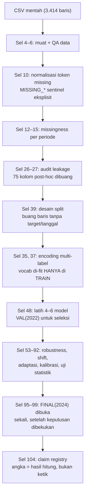

# Review Notebook — `EuRepoC_Temporal_Robustness_Research_SPRINT.ipynb`

Review kode untuk notebook utama (108 sel: 51 sel kode + 57 sel markdown).
Semua temuan di bawah disertai bukti: nomor sel, baris kode, atau isi file.
**Tidak ada file yang diubah** selain review ini sendiri.

Ringkasan satu kalimat: notebook ini **metodologinya kuat** (anti-leakage, split murni
waktu, final test disentuh sekali), tapi ada **3 masalah nyata** yang harus dibereskan:
bukti eksekusi mengendap, baseline belum pakai threshold, dan versi paket belum
dipaksa. Catatan: file notebook lama/arsip (mis. `SPRINT_OPTIMIZED`, `REVISED`)
di luar cakupan review ini.

---

## 1. Gambaran isi notebook

Alur kerja notebook, dari data mentah sampai klaim akhir:

Peta sel (bagian → fungsi):

| Sel | Bagian | Isi |
|---|---|---|
| 0–1 | Judul + setup | impor, `RANDOM_SEED = 42`, versi pustaka, `WORK_DIR` dari env |
| 4 | Muat data | cari CSV di 3 kandidat path; komentar soal `NA` = kode Namibia |
| 10 | S1.1 | token missing → sentinel eksplisit, satu dataset kerja |
| 12–15 | Missingness | per periode + vs target + heatmap |
| 26–27 | Audit leakage | daftar 75 kolom post-hoc dicek ada/tidak di fitur |
| 29–31 | Eligibility | fitur `early` / `conditional` / post-hoc → set final |
| 33–37 | Cleaning + encoding | multi-nilai → multi-hot, urutan kanonik |
| 39 | Desain split | buang baris tanpa target/tanggal, komposisi baris dibuang dilaporkan |
| 41–44 | Baseline | majority + prevalensi |
| 46 | Referensi | random split 80/20 (sekadar pembanding) |
| 48–51 | Holdout temporal | `MODEL_FACTORY`, latih di ≤2021, nilai di 3 periode |
| 53–54 | Walk-forward | uji per tahun ≤2023 |
| 56–65 | Shift + robustness | Jensen-Shannon, dekomposisi komposisi vs kualitas, uji H2 |
| 68–73 | Adaptasi | fraksi data 2023, recency, window, antar-seed |
| 75–92 | Kalibrasi/eksp/error/uji | Brier, permutation importance, Wilcoxon, sensitivitas |
| 95–99 | Final | FINAL(2024) + explainability/error di 2024 |
| 104–107 | Registry + repro | klaim dihitung otomatis, ringkasan eksekusi |

**Total 21 `assert` di seluruh notebook** — konfigurasi yang dilaporkan benar-benar
dicek terhadap yang dieksekusi. Ini bagian terbaik dari notebook ini.

---

## 2. Yang sudah bagus (pertahankan)

| # | Temuan | Bukti |
|---|---|---|
| 1 | **Leakage ditangani serius.** Kolom post-hoc tidak cuma di-drop — keberadaannya diaudit di setiap tahap (75 kolom dicatat, lalu dicek lagi di `FEATURES`). | sel 26–27 |
| 2 | **Split murni kronologis**, tanpa pengacakan. Random split hanya dibuat di satu sel dan diberi label "hanya referensi". | sel 39, 46 |
| 3 | **FINAL(2024) disentuh sekali.** Walk-forward berhenti di 2023 (`assert '2024' not in ...`), semua keputusan dibekukan sebelum sel 95. | sel 53, 95 |
| 4 | **Baris yang dibuang dilaporkan, bukan disembunyikan.** Komposisi label baris dibuang vs dipakai dicetak terbuka (drop tidak acak, dan jujur soal itu). | sel 39 |
| 5 | **Claim registry otomatis.** Setiap angka di Discussion diambil dari variabel hasil hitung (`round(..., 4)`), bukan ditik manual — angka di README tidak bisa basi diam-diam. | sel 104 |
| 6 | **Jalur data/output bisa di-override** lewat `EUREPOC_WORK_DIR`, fallback ke dataset lokal — notebook bisa jalan di mesin lain. | sel 1, 4 |
| 7 | **`NA` tidak diperlakukan sebagai NaN.** Kode ISO Namibia (`NA`) sengaja dikecualikan dari peta missing — ini bug pandas klasik dan sudah dipikirkan. | sel 4, komentar sel 10 |
| 8 | **Konfigurasi dilaporkan = konfigurasi dijalankan.** `EXPECTED_N_MODELS` / `EXPECTED_IMPORTANCE_METHOD` di-assert di sel 16 & 22, jadi narasi tidak pernah melaporkan 6 model kalau yang jalan 4. | sel 48, `README.md:107-110` |

---

## 3. Masalah (temuan utama)

### 🔴 P1 — Notebook disimpan TANPA hasil eksekusi, tapi README menyebut angka "dihitung dari sini"

**Bukti:**
- 50 dari 51 sel kode punya `execution_count = None` dan tidak ada output tersimpan
  (0 sel punya gambar). Notebook ini file "kering" — begitu dibuka, tidak ada grafik,
  tidak ada tabel, tidak ada bukti angka.
- `notebook/out/run_last.log` berisi `SEMUA SEL YANG DIJALANKAN LULUS` — tapi
  log itu tertanggal **14 Nov 01:19**, sedangkan notebook **16 Nov 15:31**.

**Mengapa penting:** README (`README.md:11-14, 91-99`) memuat angka temuan
(±63% komposisi, ρ=0,615, H1–H4) dan klaim "dihitung oleh sel notebook dari data".
Saat ini tidak ada bukti di repo bahwa versi notebook yang sekarang pernah
menghasilkan angka-angka itu — log lebih tua 2 hari dari kode.

**Perbaikan:** jalankan ulang notebook sekali (`jupyter nbconvert --to notebook
--execute --inplace ...`, jalur yang masih ada di `README.md:39-45`), simpan
output di dalam `.ipynb`, lalu pastikan `out/run_last.log` ikut ter-regenerasi
dengan tanggal yang sama atau lebih baru. Kalau repo memang disengaja kering
(ukuran kecil), README harus jujur menyebut: "jalankan dulu untuk melihat hasil".

---

### 🔴 P2 — Baseline tidak pakai threshold; bandingkan "tanpa tuning" vs "dengan tuning"

**Bukti:** seluruh notebook tidak mengandung satu pun kata `threshold` di kode
(hitungan: `threshold -> 0`). Semua evaluasi memakai `pipe.predict(...)` —
yang di scikit-learn berarti potong pada 0.5. Padahal:

- README sendiri menyebut class imbalance sebagai isu (Ransomware 1,6% di TRAIN,
  29,6% di 2023 — `opt_step2c_threshold.py` yang sudah dihapus memang dibuat
  untuk mengukur hal ini).
- Semua model pakai `class_weight='balanced'` (sel 48), sehingga probabilitas
  yang dihasilkan **tidak** berada di skala 0–1 yang sebenarnya — potong 0.5 pada
  probabilitas terkalibrasi-balanced adalah keputusan yang tidak konsisten.

**Dampak:** semua angka Macro F1 (baseline maupun model) adalah skor
"tanpa tuning threshold". Kalau dibiarkan, perbandingan antar model masih adil
(sama-sama 0.5), tapi angka absolutnya bisa jauh berbeda kalau threshold per label
di-tune di VAL — dan robustness drop yang jadi fokus riset bisa berubah.

**Perbaikan:** tambah satu sel setelah sel 48 yang melaporkan dua versi:
`@0.5` (yang sudah ada) dan `@threshold-tuned-di-VAL(2022)`. FINAL(2024) tetap
hanya memakai threshold yang sudah dibekukan di VAL — tidak melanggar protokol.

---

### 🟡 P3 — Versi paket dipakai, tapi belum dikunci; `requirements.txt` tidak memaksa

**Bukti:**
- `notebook/requirements.txt` hanya berisi 6 paket inti (pandas, numpy, scipy,
  scikit-learn, matplotlib, seaborn) — tanpa `jupyter` (padahal butuh untuk
  menjalankan), tanpa versi paket untuk `xgboost`/`lightgbm`/`shap`.
- README (`README.md:103-110`) menyatakan lingkungan eksekusi hanya **4 model**
  karena XGBoost/LightGBM tidak terpasang, dan `MODEL_FACTORY` jatuh ke mode
  reduced (sel 48 mencetak peringatan ini otomatis).
- Notebook punya assert (`EXPECTED_N_MODELS`) untuk ini — bagus, tapi artinya
  **hasil bisa beda antar mesin**: mesin dengan xgboost terpasang menghasilkan
  6 model, mesin tanpa menghasilkan 4, dan keduanya sah menurut assert.

**Dampak:** reproduktifitas bergantung pada mesin. Angka di README dihasilkan
dari lingkungan 4-model; di mesin lain bisa berbeda tanpa ada yang salah.

**Perbaikan:** (a) tambah `jupyter` ke `requirements.txt`; (b) putuskan satu
standar — mau 4 model (kunci `xgboost`/`lightgbm`/`shap` = TIDAK dipakai) atau
6 model (kunci versinya dan tambahkan ke requirements) — lalu samakan angka
`EXPECTED_N_MODELS` dan kalimat README dengannya.

---

### 🟡 P4 — CSV tidak dicek integritasnya, padahal klaimnya "tanpa state eksternal"

**Bukti:** grep seluruh kode notebook: nol kemunculan `sha256`/`md5`/`hashlib`/
`checksum`. Notebook hanya membaca `eurepoc_global_dataset_1_3.csv` dari 3 kandidat
path (sel 4) tanpa memverifikasi isinya. Klaim sel 106: "hasil dihasilkan ulang
dari satu file tersebut tanpa state eksternal".

**Dampak:** kalau CSV diganti diam-diam (versi dataset berbeda, export ulang
dengan delimiter/encoding beda), semua angka di-regenerasi dengan percaya diri —
claim registry ikut menyesuaikan — dan tidak ada yang sadar angka-angka di
README sudah tidak relevan.

**Perbaikan:** satu baris di sel 4:
`RAW_SHA256 = '...'` + assert hash file. Kalau dataset memang sengaja bisa
berganti, ganti klaim di sel 106 menjadi "dari file CSV yang diberikan"
(bukan menyiratkan angka README tetap berlaku untuk CSV mana pun).

---

### 🟡 P5 — `warnings.filterwarnings('ignore')` global menutupi sinyal penting

**Bukti:** sel 1, baris: `warnings.filterwarnings('ignore')` (1 kemunculan,
bersifat global sepanjang notebook).

**Dampak:** peringatan pandas (downcasting, `SettingWithCopyWarning`), sklearn
(konvergensi `LogisticRegression`, `max_iter=2000` mungkin tidak cukup), dan
deprecations semuanya senyap. Notebook ini punya 21 assert yang dibangun untuk
menangkap masalah — peringatan adalah lapisan deteksi gratis yang dimatikan.

**Perbaikan:** ganti jadi `warnings.filterwarnings('error', category=FutureWarning)`
atau minimal catat jumlah peringatan di ringkasan repro (sel 105) supaya
kenaikan peringatan antar eksekusi terlihat.

---

### 🟡 P6 — README & dokumen sprint menunjuk berkas yang sudah dihapus

**Bukti** (semua path di bawah sudah tidak ada setelah `tools/` dihapus):

| lokasi | menyebut |
|---|---|
| `README.md:24, 34, 37` | `notebook/tools/run_notebook.py` |
| `README.md:25, 67-70` | `notebook/tools/export_dashboard_data.py` + seluruh seksi "Menjalankan dashboard" (baris 55–70) |
| `README.md:27` | `dashboard/` (React/Vite) |
| `notebook/SPRINT_REVISI_PENELITIAN.md:487` | "verifikasi lewat `tools/run_notebook.py`" |

Sisi baik: alternatif `jupyter nbconvert` di `README.md:39-45` **masih valid** —
jalur menjalankan notebook belum putus total.

**Perbaikan:** buang seksi dashboard dari README, ganti instruksi jalankan
notebook ke nbconvert, dan ubah klaim verifikasi di `SPRINT_REVISI_PENELITIAN.md`
menjadi jalur yang benar-benar ada.

---

### 🟡 P7 — Sisa artefak skrip yang sudah mati + `node_modules` yatim 566 MB

**Bukti:**
- `notebook/out/` berisi 9–10 file hasil eksperimen yang sudah tidak bisa
  diregenerasi (skripnya dihapus): `opt_cache/features.npz`, `opt_f_features.json`,
  `opt_g_models.json/.log`, `opt_h_shift.json`, `opt_i_adapt2.json`,
  `opt_search_2c.json`, `opt_final_verification.json`, `opt_winner.json`.
- `node_modules/` di root, **566 MB**, tanpa `package.json`/`vite.config.*` —
  sisa `dashboard/` yang ikut terhapus. Total `notebook/` hanya 14 MB; artinya
  ±97% ukuran direktori kerja adalah folder yatim ini.

**Perbaikan:** hapus kedua-duanya; keduanya tidak punya konsumen dan tidak bisa
dipakai ulang. (Kode mati redundan `tools/*.py` sendiri sudah ikut terhapus —
temuan duplikasi lintas file dari review sebelumnya otomatis gugur.)

---

## 4. Perhatian kecil (tidak mendesak)

| # | Temuan | Bukti |
|---|---|---|
| c1 | Impor `pickle` dan `ast` dipakai — tapi apakah benar-benar dipakai? perlu dicek sekali (hitung: `pickle` muncul 1×, `ast` 2× — kemungkinan hanya impor mati). | sel 1 |
| c2 | `train_test_split` hanya dipakai di sel random-split referensi — impor di sel 1 aman, tapi pastikan satu-satunya pemakaian memang sel 46. | sel 1, 46 |
| c3 | Penomoran bagian tidak berurutan di kode: sel 49 diberi judul `19.0` tapi muncul setelah `16`, dan `26.1` muncul setelah `25`. Tidak merusak apa pun, tapi membingungkan saat mencari bagian. | sel 49, 97 |
| c4 | README (`README.md:20`) menyebut "51 sel kode" — cocok dengan hitungan (51). Angka ini **sudah benar**, pertahankan. | README |
| c5 | `requirements.txt` tidak mencantumkan `jupyter` — sudah termasuk dalam P3, dicatat ulang karena berbeda dari paket analisis. | `requirements.txt` |

---

## 5. Prioritas perbaikan

| Prioritas | Masalah | Usaha | Dampak |
|---|---|---|---|
| **1** | P1 — eksekusi mengendap (output kosong, log lebih tua) | rendah (jalankan nbconvert) | mengembalikan bukti seluruh angka README |
| **2** | P6 — README menunjuk file mati | rendah (edit README) | pembaca baru tidak lagi menemui jalan buntu |
| **3** | P7 — hapus `node_modules/` + artefak `out/opt_*` | rendah | −566 MB, repo bersih |
| **4** | P2 — baseline pakai threshold VAL | sedang (tambah 1 sel + jalankan ulang) | angka absolut jadi bermakna |
| **5** | P3 — kunci versi + `jupyter` di requirements | sedang | hasil identik antar mesin |
| **6** | P4 — assert hash CSV | rendah | deteksi dataset terganti |
| **7** | P5 — jangan bisukan semua warning | rendah | lapisan deteksi gratis aktif |

---

## 6. Batasan review ini

- Review berbasis pembacaan kode + pemeriksaan file (grep, diff sel-per-sel,
  cek `execution_count`, cek mtime). **Notebook tidak dijalankan ulang** di
  sesi ini — jadi klaim angka dalam notebook (H1–H4, ρ, drop %) tidak
  diverifikasi ulang terhadap data; yang diverifikasi adalah *mehanisme*
  menghitungnya (registry otomatis, assert, protokol split).
- Temuan P1 (output kosong) adalah fakta file; temuan P2 (nol `threshold`)
  adalah fakta kode; temuan P3–P7 adalah fakta file/dokumen. Interpretasi
  dampaknya adalah penilaian teknis, ditandai sebagai penilaian bukan bukti.